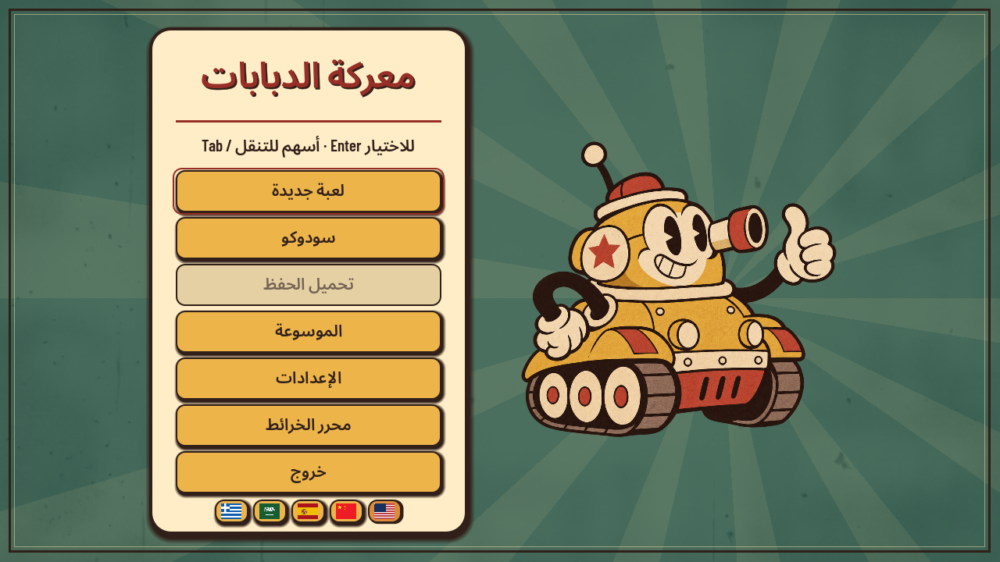
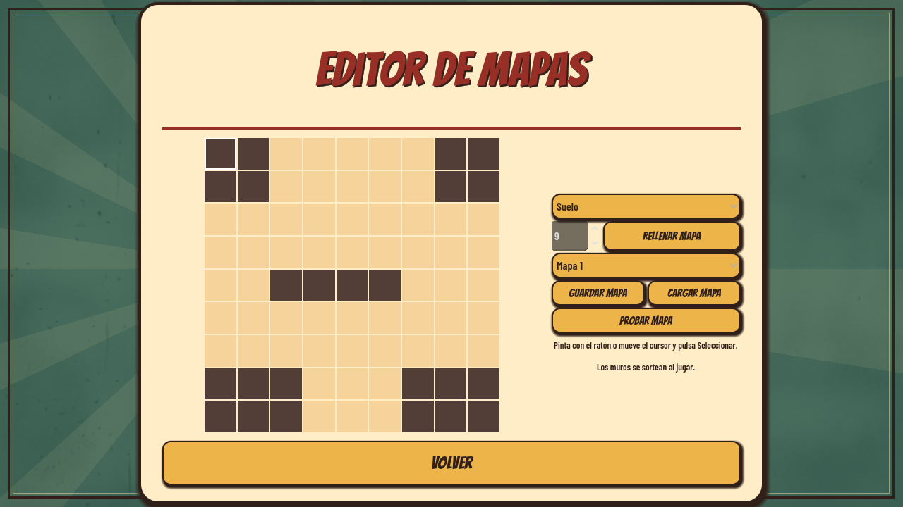
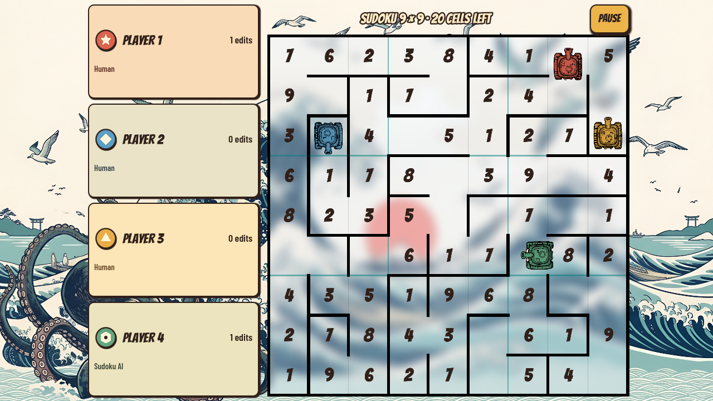
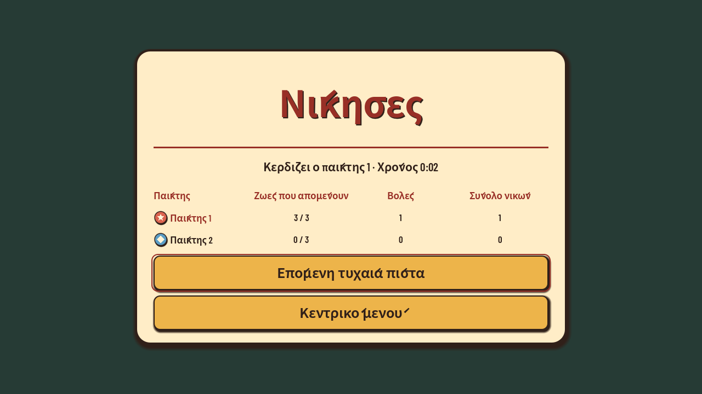

# Tank Trouble

A local multiplayer tank game set in hand-painted cartoon mazes. Bank shots around corners, race for power-ups, or work together to solve Sudoku with cannon fire. Play with **2–8 tanks**, including up to **3 local human players**. Fill the other slots with AI or practice targets.

## Play

1. Install **Godot 4.7.2 .NET** and the **.NET 8 SDK** used by this project. [Godot download](https://godotengine.org/download/archive/4.7.2-stable/) · [.NET SDK download](https://dotnet.microsoft.com/download/dotnet/8.0)
2. Clone or download the repository. Import `project.godot` in Godot, then press **F5**. Build the C# project in the editor if prompted.
3. Choose **New Game** for tank battles or **Sudoku** for cooperative play. In **New Game**, the **Arena** picker offers the campaign, individual stages, saved custom maps, and your editor draft.

| Default controls | Human 1 | Human 2 | Human 3 |
| --- | --- | --- | --- |
| Drive and turn | WASD | Arrow keys | IJKL |
| Fire | F | Enter | O |

**Esc** pauses or goes back. Use **Tab** or the arrow keys to move through menus and **Enter** to select. On a gamepad, use the left stick to drive and **A** to fire. **Settings → Controls** lets you remap keyboard and gamepad inputs. The language flags switch between English, Simplified Chinese, Spanish, Arabic, and Greek.

## Arenas, weapons, and opponents

Fight through seven arenas with freshly generated walls. Steam Foundry has a conveyor lane and barrels that can break interior walls. Moon Crater has lethal meteor strikes, a pulsing gravity well, and the one-shot Portal Gun. In Lucky Grove, 3D Cube Pets wander the maze and flowers recharge shields.

Each tank starts with three lives. Pickup rings show the shots or time remaining, and the HUD identifies each bot’s difficulty. Choose Beginner, Intermediate, Advanced, or Random separately for State Machine, Behavior Tree, GOAP, Utility + Lookahead, and Neural Self-Play. [AI design and benchmarks](docs/enemy_AI.md)

## Paint a map

Open **Map Editor**, paint the playable cells, and leave empty space to shape the arena. Save to one of three local slots or use **Playtest**. Keep the painted cells connected edge to edge. Every match rolls new walls inside your footprint.

## Solve Sudoku together

Shoot an editable cell to increment it. Values wrap back to 1 after the highest digit. Start with the default **9×9** board, choose another supported size, or pick **Random**. Sudoku bots know the solution and take turns driving into position and firing.

## Finish a round

The results screen shows elapsed time, remaining lives, shots fired, and total wins. Continue the campaign when available, play a different random level with the same roster, or return to the main menu. Sudoku results show each player’s edits and offer a new random puzzle. During campaign play, **Pause → Save Checkpoint** saves your progress.

## Credits

- The menu mascot, arena backdrops, and maze materials were created for this project with ImageGen.
- The 3D animals are CC0 models. [Kenney Cube Pets](https://kenney.nl/assets/cube-pets)
- Bangers and Barlow Condensed are included under the SIL Open Font License. [Bundled font notices](UI/Art/Fonts)
- The menu, pickup, and firing sounds use CC0 assets. [Boings](https://opengameart.org/content/boings) · [Balloon Sounds](https://opengameart.org/content/balloon-sounds)
