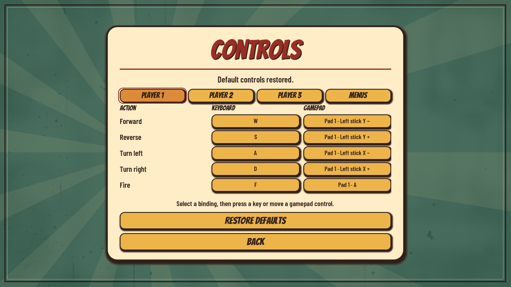
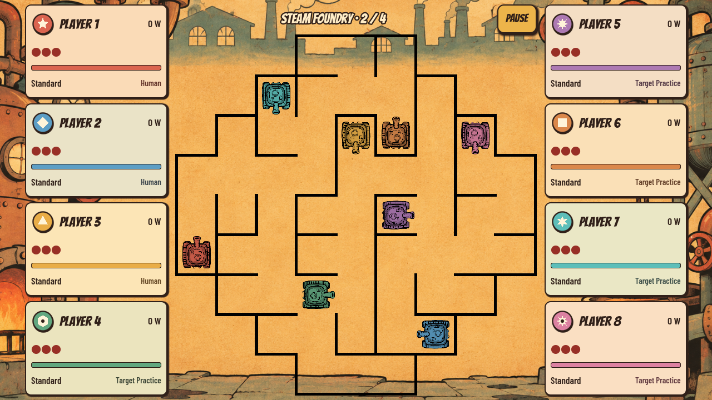
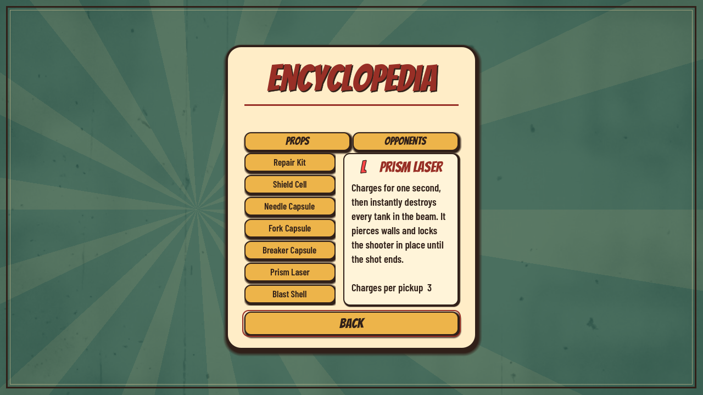

# Tank Trouble

Tank Trouble is a retro-cartoon maze game with ricocheting shells, timed pickups, and three-life matches. Build a roster of two to eight tanks with up to three local human players, AI opponents, or stationary practice targets.

## Run the game

1. Install [Godot 4.7.2 .NET](https://godotengine.org/download/archive/4.7.2-stable/) and the [.NET 8 SDK](https://dotnet.microsoft.com/download/dotnet/8.0).
2. Import `project.godot` into the Godot project manager and press **F5**. Build the C# project in the editor if prompted.
3. Select **New Game** for Arena or **Sudoku** for cooperative puzzle play. Choose a board size or **Random**, then use **+** and **×** to set up the roster. The standard edition of Godot can open the GDScript gameplay, but C# opponents require the .NET edition.

| Action | Human 1 | Human 2 | Human 3 |
| --- | --- | --- | --- |
| Drive and turn | WASD | Arrow keys | IJKL |
| Fire | F | Enter | O |
| Pause or resume | Esc | Esc | Esc |

Use **Tab**, **Shift+Tab**, or the arrow keys to move through menus and **Enter** to select. **Esc** goes back or pauses the match. Gamepads use the left stick to drive and **A** to fire by default, with one pad per human slot. Use **Settings** to capture a different key, button, or stick direction. Changes save automatically. **Restore Defaults** asks for confirmation before replacing the saved bindings.

Choose a flag on the main menu to switch between English, Simplified Chinese, Spanish, Arabic, and Greek. The game remembers your choice.

Use **Pause → Save Checkpoint** to save arena progress. Loading a checkpoint restarts the saved arena with its recorded score and opponent selection.

## Arena and AI

Each tank has three lives per arena. Pickups grant repairs, shields, or limited-charge weapons. The dashed red laser warning lasts one second before the lethal beam pierces walls. The shooter stays in place until the beam ends.

The campaign starts on the Studio Backlot and continues through the Steam Foundry, Moon Crater, and Lucky Grove. Foundry steam vents deal one point of damage. Moon meteors destroy tanks and destructible objects in a 3×3 impact area and leave visible flames for ten seconds. Lucky Grove fountains heal one point when they pulse. The campaign also includes Keyhole Keep, Switchback, and Split Fork, with uneven footprints.

Choose from State Machine, Behavior Tree, GOAP, Utility + Lookahead, and Neural Self-Play. Open the Encyclopedia to learn about each controller and pickup. See [enemy AI notes](docs/enemy_AI.md) for the controller components, benchmark commands, and historical training results.

The Portal Gun fires one shot to place a pair of gates. Its destination is a random free cell. The pair closes after one traversal or ten seconds. Turbo Tonic boosts driving speed by 40% for five seconds.

The **Map Editor** on the main menu lets you paint floor and empty space, save to three local slots, and playtest with your chosen roster. Connect the painted cells edge to edge and leave at least one cell per player. Each playtest generates new walls inside your painted footprint.

Wandering 3D animals use CC0 models from [Kenney Cube Pets](https://kenney.nl/assets/cube-pets).

## Sudoku

Two to eight tanks share one puzzle, with up to three human players. Shoot a non-clue cell to increment its value. After the highest value, the next hit wraps the cell back to 1. A 9×9 board is the default. Set a fixed size or choose **Random** to draw one of the supported board sizes.

Sudoku AI knows the solution, drives to the cells it needs to edit, and uses normal shells. All Sudoku bots share a limit of roughly one shot every 2.4 seconds. They travel to separate cells and take turns firing when lined up.

## Asset credits

- The main-menu mascot is an original ImageGen illustration created for this project.
- [Bangers](https://github.com/googlefonts/bangers) by Vernon Adams and [Barlow Condensed](https://github.com/jpt/barlow) by Jeremy Tribby are bundled under the SIL Open Font License. Their notices are in [UI/Art/Fonts](UI/Art/Fonts).
- [Boings](https://opengameart.org/content/boings) by EZduzziteh supplies the menu and pickup cues. [Balloon Sounds](https://opengameart.org/content/balloon-sounds), prepared by AntumDeluge from Gniffelbaf’s recording, supplies the firing pop. Both sound packs are distributed under [CC0 1.0](https://creativecommons.org/publicdomain/zero/1.0/).
