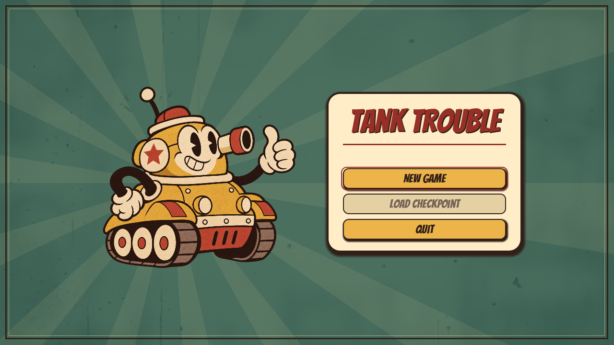
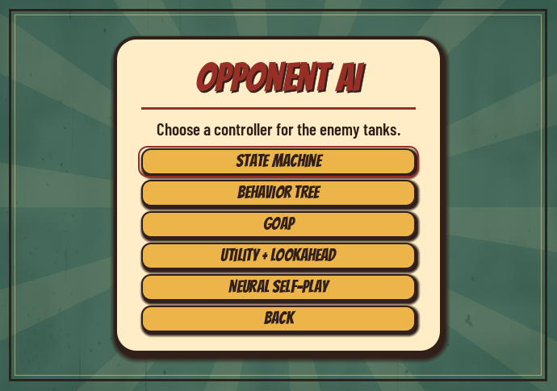
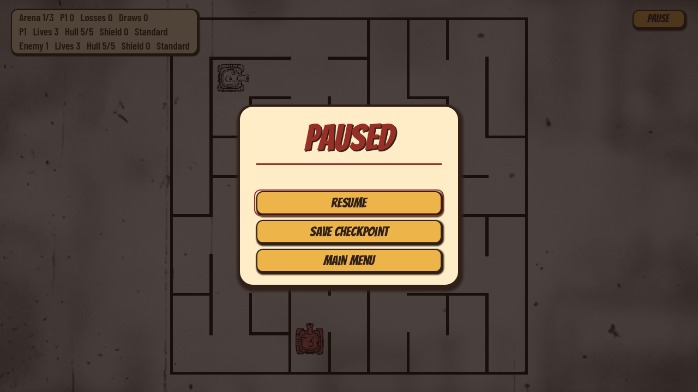

# Tank Trouble

Tank Trouble is a retro-cartoon maze game with ricocheting shells, timed pickups, and three-life matches. Play solo against an AI controller, practice against stationary targets, or play local two-player versus.

## Run the game

1. Install [Godot 4.7.2 .NET](https://godotengine.org/download/archive/4.7.2-stable/) and the [.NET 8 SDK](https://dotnet.microsoft.com/download/dotnet/8.0).
2. Import `project.godot` into the Godot project manager and press **F5**. Build the C# project in the editor if prompted.
3. Select **New Game**, then pick AI, local versus, or target practice. The standard edition of Godot can open the GDScript gameplay, but C# opponents require the .NET edition.

| Action | Player 1 | Player 2 |
| --- | --- | --- |
| Drive and turn | WASD | Arrow keys |
| Fire | F | Enter |
| Pause or resume | Esc | Esc |

Use **Pause → Save Checkpoint** to save arena progress. Loading a checkpoint restarts the saved arena with its recorded score and opponent selection.

## Arena and AI

Each tank has three lives per arena. Pickups grant repairs, shields, or limited-charge weapons. The red laser charges for one second before piercing walls, and the shooter stays in place until the beam ends.

Solo play includes State Machine, Behavior Tree, GOAP, Utility + Lookahead, and Neural Self-Play. See [enemy AI notes](docs/enemy_AI.md) for the controller components, benchmark commands, and historical training results.

## Asset credits

- The main-menu mascot is an original ImageGen illustration created for this project.
- [Bangers](https://github.com/googlefonts/bangers) by Vernon Adams and [Barlow Condensed](https://github.com/jpt/barlow) by Jeremy Tribby are bundled under the SIL Open Font License. Their notices are in [UI/Art/Fonts](UI/Art/Fonts).
- [Boings](https://opengameart.org/content/boings) by EZduzziteh supplies the menu and pickup cues. [Balloon Sounds](https://opengameart.org/content/balloon-sounds), prepared by AntumDeluge from Gniffelbaf’s recording, supplies the firing pop. Both sound packs are distributed under [CC0 1.0](https://creativecommons.org/publicdomain/zero/1.0/).
